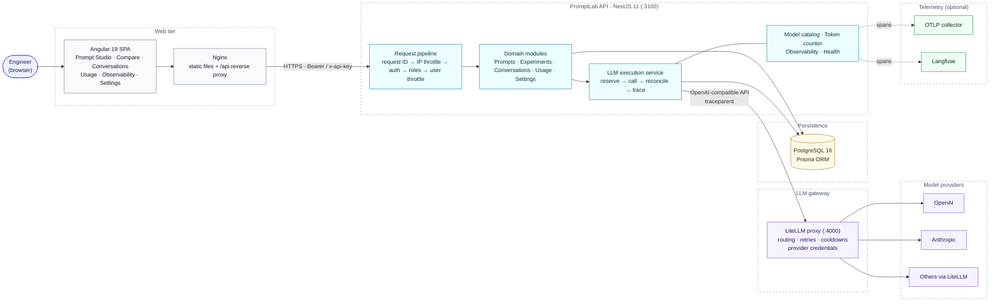
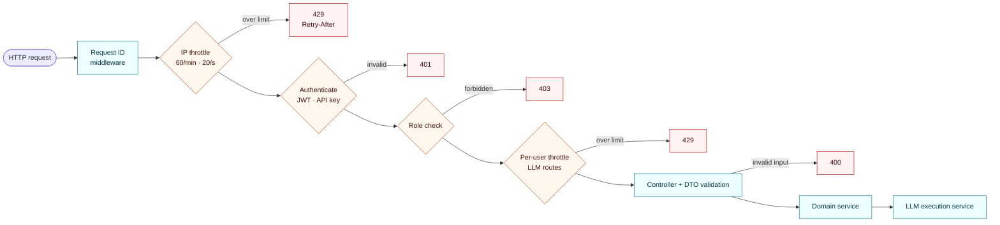
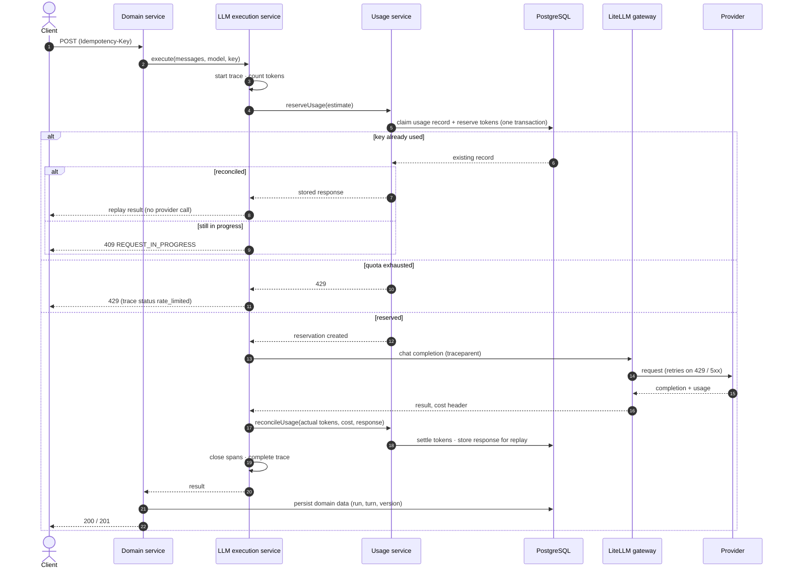
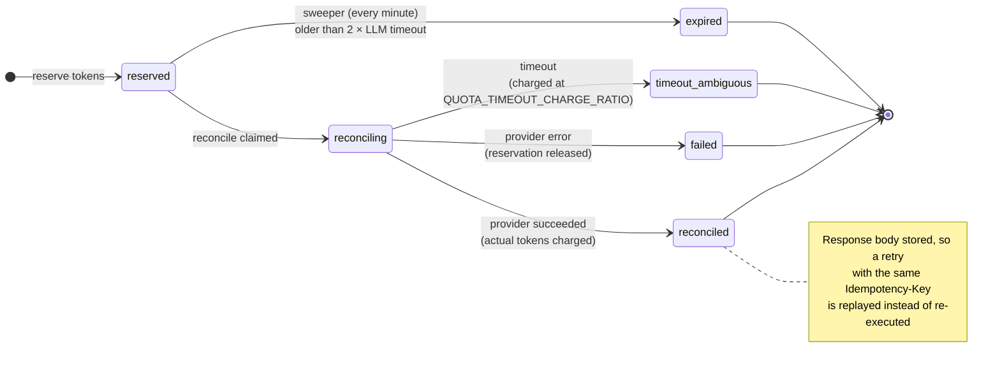
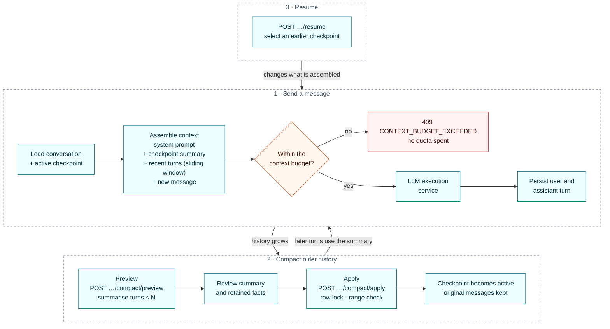
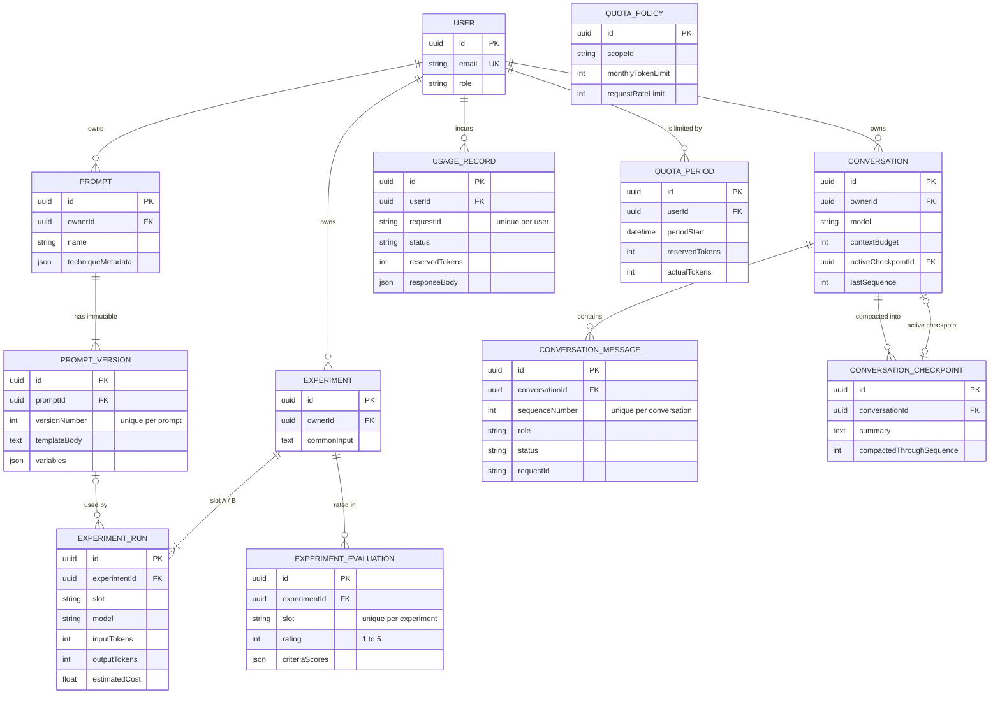
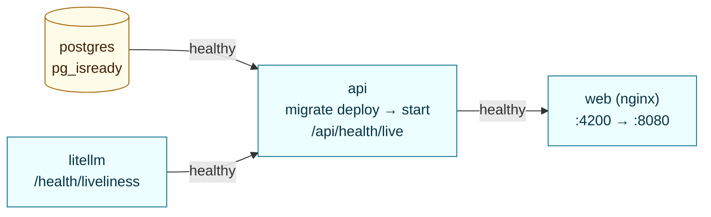
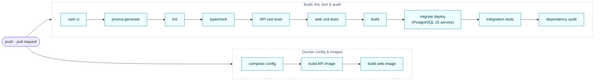

# PromptLab

**A prompt engineering workspace and LLM gateway.** PromptLab lets a team write versioned prompt templates, compare models side by side, run long conversations within a context budget, and keep token spend under control. Every model call goes through a single, audited path.

[](.github/workflows/ci.yml)


---

## Contents

1. [Features](#features)
2. [Architecture](#architecture)
3. [How a model call works](#how-a-model-call-works)
4. [Usage accounting](#usage-accounting)
5. [Conversations and context compaction](#conversations-and-context-compaction)
6. [Data model](#data-model)
7. [Tech stack](#tech-stack)
8. [Repository layout](#repository-layout)
9. [Getting started](#getting-started)
10. [Configuration](#configuration)
11. [Authentication and roles](#authentication-and-roles)
12. [API reference](#api-reference)
13. [Testing and CI](#testing-and-ci)
14. [Observability](#observability)
15. [Security](#security)
16. [Documentation](#documentation)

---

## Features

| Area | What it does |
| :--- | :--- |
| **Prompt Studio** | Templates built on prompting techniques (zero-shot, few-shot, role/task/format, structured output). `{{variable}}` placeholders are detected automatically and the resolved prompt is previewed live. Versions are immutable (`v1`, `v2`, …), so every run can be traced back to the exact template it used. |
| **Model comparison** | Runs the same input against two prompt/model slots at once. Shows latency, token usage and cost for each slot, and records a 1–5 rating, notes and per-criterion scores. |
| **Conversations** | Multi-turn chat with a visible context budget. The prompt sent to the model is assembled with a sliding window, and a request is rejected with `409 CONTEXT_BUDGET_EXCEEDED` *before* any tokens are spent. |
| **Context compaction** | Summarises older turns into a checkpoint that you can preview before applying. The checkpoint replaces those turns in future prompts, and the original messages are kept. You can resume from any earlier checkpoint. |
| **Quota governance** | Each user has a monthly token allowance and request rate limits. Tokens are reserved before a call and reconciled after it, so concurrent requests cannot overspend. Every call is recorded in a usage ledger. |
| **Idempotent execution** | Clients send an `Idempotency-Key` header. A retried request replays the stored result instead of calling the model, and therefore paying, a second time. |
| **Model catalog** | Context limits and pricing are read from the gateway's `/model/info` and cached. Token counts come from a local, model-aware tokenizer (`js-tiktoken`). |
| **Observability** | W3C `traceparent` propagation, span trees per request, an in-memory trace viewer, and optional export to OpenTelemetry (OTLP/HTTP) and Langfuse. Secrets are redacted before anything is exported or logged. |
| **Operations** | Liveness and readiness probes, a read-only settings dashboard, RFC 9457 error responses, request IDs on every response, and a Docker Compose stack with health-gated startup. |

---

## Architecture

PromptLab is a **modular monolith** (NestJS) with an Angular single-page app in front of it. All provider traffic goes through a separate **LiteLLM** gateway. Provider API keys stay in the gateway and never reach the API process or the browser.



Key design decisions. Each one is recorded as an ADR in [`docs/knowledge/decisions`](docs/knowledge/decisions/index.md):

- **One execution path for every model call.** Playground runs, comparison slots, conversation turns and compaction previews all go through `LlmExecutionService`. Quotas, idempotency, cost and tracing therefore behave the same way everywhere ([ADR-001](docs/knowledge/decisions/adr-001-modular-monolith-nestjs.md), [ADR-004](docs/knowledge/decisions/adr-004-atomic-quota-reservations.md)).
- **Gateway owns provider concerns.** LiteLLM holds the credentials, retries and cooldowns. Its per-attempt timeout (25 s) is kept below the API's own timeout (30 s), so a slow provider fails cleanly instead of leaving an ambiguous charge ([ADR-002](docs/knowledge/decisions/adr-002-litellm-proxy-gateway.md), [ADR-015](docs/knowledge/decisions/adr-015-health-probes-and-gateway-resilience.md)).
- **The gateway is the source of truth for models.** Context limits and prices come from the gateway catalog, not from hard-coded tables ([ADR-012](docs/knowledge/decisions/adr-012-model-catalog-and-structural-error-classification.md)).

---

## How a model call works

Every LLM-backed request passes the same guard chain before it reaches a controller:



Inside the execution service, quota is reserved before the provider is called. Reconciliation runs in a `finally` block, so a reservation is never left behind, even if the call throws:



---

## Usage accounting

Each model call has one row in the usage ledger. The status moves forward only, and every transition is a single guarded update. That rules out double-charging and lost reservations, even with several API instances running:



- The sweeper uses `FOR UPDATE SKIP LOCKED`, so several API instances can run it safely at the same time.
- Monthly quota periods roll over automatically. The default allowance is **1,000,000 tokens per user per month**, and administrators can change it per user.

---

## Conversations and context compaction

Each turn is assembled from the system prompt, the active checkpoint summary (if any), as many recent turns as fit in the budget, and the new user message. Compaction is a two-step, user-confirmed operation:



---

## Data model



The schema is managed with versioned Prisma migrations in [`apps/api/prisma/migrations`](apps/api/prisma/migrations). Migrations are only ever added, never edited.

---

## Tech stack

| Layer | Technology |
| :--- | :--- |
| Frontend | Angular 19 (standalone components, signals), Lucide icons, Karma + Jasmine |
| Backend | NestJS 11, class-validator, `@nestjs/throttler`, `@nestjs/terminus`, `@nestjs/schedule`, Jest |
| Data | PostgreSQL 16, Prisma 6 |
| LLM gateway | LiteLLM proxy 1.106 (pinned by digest) |
| Tokenisation | `js-tiktoken` with model-aware encoding selection |
| Observability | W3C trace context, OTLP/HTTP exporter, Langfuse exporter, in-memory trace buffer |
| End-to-end tests | Playwright |
| Delivery | Docker multi-stage images, Docker Compose, Nginx, GitHub Actions |

---

## Repository layout

```text
.
├── apps/
│   ├── api/                    NestJS API
│   │   ├── prisma/             schema.prisma + versioned migrations
│   │   └── src/
│   │       ├── common/         config, guards, filters, decorators, middleware
│   │       ├── llm/            LlmExecutionService (single path for model calls)
│   │       ├── prompts/        templates and immutable versions
│   │       ├── experiments/    side-by-side comparison and evaluations
│   │       ├── conversations/  turns, context assembly, compaction, checkpoints
│   │       ├── usage/          quota policy, reservations, ledger, sweeper
│   │       ├── providers/      gateway client and model catalog
│   │       ├── tokens/         model-aware token counting
│   │       ├── observability/  tracing, exporters, redaction
│   │       ├── health/         liveness, readiness, diagnostics
│   │       └── settings/       read-only system settings
│   └── web/                    Angular SPA (pages, services, interceptors)
├── e2e/                        Playwright flows
├── infra/litellm/              gateway config and local runner
├── scripts/                    end-to-end flow runner
├── docs/                       architecture, ADRs, concepts, runbooks
├── docker-compose.yml
└── .github/workflows/ci.yml
```

---

## Getting started

### Option A: Docker Compose (recommended)

Requirements: Docker with Compose v2.

```bash
cp .env.example .env        # then set the required values below
docker compose up --build -d
docker compose ps           # wait until every service is "healthy"
```

| Variable | Notes |
| :--- | :--- |
| `POSTGRES_PASSWORD` | Required. Must be URL-safe (no `@ : / ? #`) because it is embedded in `DATABASE_URL`. |
| `LITELLM_MASTER_KEY` | Required. The secret the API uses to call the gateway. |
| `AUTH_API_KEYS` and/or `AUTH_JWT_SECRET` | At least one is required. See [Authentication](#authentication-and-roles). |
| `OPENAI_API_KEY`, `ANTHROPIC_API_KEY`, `GEMINI_API_KEY` | Optional. Only needed for live model calls. |

Services start in dependency order, and each one waits for the previous one to report healthy:



All ports are bound to `127.0.0.1` only. Open **http://localhost:4200** and sign in with one of the keys from `AUTH_API_KEYS`.

| Service | Host port | Health check |
| :--- | :--- | :--- |
| Web | 4200 | `GET /` |
| API | 3100 | `GET /api/health/live` |
| LiteLLM | 4000 | `GET /health/liveliness` |
| PostgreSQL | 5432 | `pg_isready` |

Host ports can be changed with `WEB_HOST_PORT`, `API_HOST_PORT`, `LITELLM_HOST_PORT` and `POSTGRES_HOST_PORT`.

### Option B: Local development

Requirements: Node.js 22 (see `.nvmrc`), npm 10, PostgreSQL 16, Python 3.10+ (for the LiteLLM gateway).

```bash
cp .env.example .env                              # point DATABASE_URL at your local PostgreSQL
npm install
npm run prisma:generate
npm run prisma:deploy                             # apply migrations

pip install -r infra/litellm/requirements.txt
npm run start:gateway                             # LiteLLM on :4000
npm run start:api                                 # API on :3100 (watch mode)
npm run start:web                                 # SPA on :4200, proxies /api to :3100
```

Without provider keys you can still use everything except live completions: templates, previews, version history, context inspection, quotas, tracing and settings.

---

## Configuration

All configuration is validated once at startup (`apps/api/src/common/config/env.validation.ts`). The API refuses to start in production if a secret is missing, too short or still set to a known default. [`.env.example`](.env.example) documents every variable. The most important ones:

| Variable | Default | Purpose |
| :--- | :--- | :--- |
| `NODE_ENV` | `production` | Development conveniences are enabled only for `development` / `test`. |
| `PORT` | `3100` | API port. |
| `CORS_ORIGIN` | — | Comma-separated list of allowed origins. |
| `DATABASE_URL` | — | PostgreSQL connection string. |
| `LITELLM_GATEWAY_URL` | `http://127.0.0.1:4000` | Gateway base URL. |
| `LITELLM_MASTER_KEY` | — | Gateway credential. Required in production. |
| `AUTH_API_KEYS` | — | `key:userId:role` entries, comma-separated. Each key must be at least 32 characters in production. |
| `AUTH_JWT_SECRET` | — | HS256 secret for bearer tokens (at least 32 characters in production). Optional `AUTH_JWT_ISSUER`, `AUTH_JWT_AUDIENCE`, `AUTH_JWT_MAX_LIFETIME_SECONDS`. |
| `TRUST_PROXY` | `false` | Hop count or CIDR of a trusted reverse proxy. `true` is rejected. |
| `LLM_REQUEST_TIMEOUT_MS` | `30000` | API-side timeout for a provider call. Must stay above the gateway's `request_timeout`. |
| `QUOTA_TIMEOUT_CHARGE_RATIO` | `0.5` | Share of reserved tokens charged when a call times out ambiguously. |
| `MODEL_CATALOG_TTL_MS` | `300000` | Cache lifetime of the gateway model catalog. |
| `ENABLE_TELEMETRY` | `true` | Enables tracing and export. |
| `OTEL_EXPORTER_OTLP_ENDPOINT` | — | OTLP/HTTP collector, e.g. `http://localhost:4318`. |
| `LANGFUSE_PUBLIC_KEY` / `LANGFUSE_SECRET_KEY` / `LANGFUSE_HOST` | — | Langfuse export. |

Gateway behaviour (models, timeouts, retry policy, cooldowns) lives in [`infra/litellm/config.yaml`](infra/litellm/config.yaml). A unit test checks that its timing settings stay compatible with the API's own timeout.

---

## Authentication and roles

Every route except the health probes requires authentication. There are two ways to authenticate:

- `x-api-key: <key>`, where the key is one of the entries in `AUTH_API_KEYS`.
- `Authorization: Bearer <jwt>`, a token signed with `AUTH_JWT_SECRET`. Only HS256 is accepted, and issuer, audience and maximum lifetime are checked when configured.

The web app's sign-in page accepts either one. The SPA attaches the credential only to requests sent to its own API.

Roles come from the key entry or the JWT claims. Routes marked **admin** in the table below require the `admin` role.

---

## API reference

All routes are prefixed with `/api`. Errors use **RFC 9457** `application/problem+json`, and every response carries an `X-Request-Id`. Routes that call a model accept an `Idempotency-Key` header and are subject to the per-user rate limit.

| Method | Route | Description | Access |
| :--- | :--- | :--- | :--- |
| `GET` | `/health/live` | Liveness probe. Returns 200 while the process can serve requests. | public |
| `GET` | `/health/ready` | Readiness probe. Returns 200 when PostgreSQL and the gateway are reachable, otherwise 503. | public |
| `GET` | `/health` | Diagnostic snapshot (database latency, gateway status, configured providers). | public |
| `GET` | `/prompts` | List prompts (`limit`, `offset`, `search`, `technique`). | user |
| `GET` | `/prompts/:id` | Prompt with its version history. | user |
| `POST` | `/prompts` | Create a prompt and its first version. | user |
| `POST` | `/prompts/:id/versions` | Append an immutable version. | user |
| `POST` | `/prompts/preview` | Resolve a template with variables, without calling a model. | user |
| `POST` | `/prompts/run` | Run a prompt in the playground. | user · idempotent |
| `GET` | `/experiments` | List comparisons (`limit`, `offset`). | user |
| `GET` | `/experiments/:id` | Comparison with both runs and evaluations. | user |
| `POST` | `/experiments/run` | Run two slots side by side. | user · idempotent |
| `POST` | `/experiments/:id/rate` | Save a rating, notes and criterion scores for a slot. | user |
| `GET` | `/conversations` | List conversations (`limit`, `offset`). | user |
| `POST` | `/conversations` | Create a conversation (model, system prompt, context budget). | user |
| `GET` | `/conversations/:id` | Conversation with messages and checkpoints. | user |
| `DELETE` | `/conversations/:id` | Delete a conversation. | user |
| `GET` | `/conversations/:id/context` | Inspect the assembled context and budget usage. | user |
| `POST` | `/conversations/:id/messages` | Send a turn. | user · idempotent |
| `POST` | `/conversations/:id/compact/preview` | Generate a compaction summary for review. | user · idempotent |
| `POST` | `/conversations/:id/compact/apply` | Apply a reviewed summary as the active checkpoint. | user |
| `POST` | `/conversations/:id/resume` | Switch the active checkpoint. | user |
| `GET` | `/usage/status` | Current period: limit, reserved, used, remaining. | user |
| `GET` | `/usage/ledger` | Recent usage records. | user |
| `GET` | `/usage/policy` | Effective quota policy. | user |
| `PUT` | `/usage/policy` | Update your own quota policy. | admin |
| `PUT` | `/usage/policy/:userId` | Update another user's quota policy. | admin |
| `POST` | `/usage/reset` | Reset the current period (only when demo endpoints are enabled). | admin |
| `GET` | `/providers/models` | Models available through the gateway. | user |
| `POST` | `/tokens/estimate` | Model-aware token estimate for a text or message list. | user |
| `GET` | `/settings` | Read-only runtime configuration (no secrets). | admin |
| `GET` | `/observability/status` | Exporter and redaction status. | user |
| `GET` | `/observability/traces` | Recent traces. | admin |
| `GET` | `/observability/traces/:traceId` | One trace with its span tree. | admin |
| `POST` | `/observability/clear` | Clear the in-memory trace buffer. | admin |

---

## Testing and CI

| Command | What it runs |
| :--- | :--- |
| `npm run lint` | ESLint for API and web (zero warnings allowed). |
| `npm run typecheck` | `tsc --noEmit` for API and web. |
| `npm run test:unit` | API unit tests (Jest). |
| `npm run test:integration` | API integration tests against a real PostgreSQL database (HTTP → guards → services → Prisma). |
| `npm run test:web` | Web unit tests (Karma, headless Chrome). |
| `npm run test:e2e` | Playwright user journeys (needs a running stack). |
| `npm run test:flows` | The same journeys with a structured JSON report and screenshots. |
| `npm run build` | Production builds of API and web. |
| `npm run audit` | Dependency audit with an allow-list that has expiry dates (`audit-ci.json`). |

GitHub Actions runs two jobs on every push to `main` or a `remediation/**` branch, and on pull requests into `main`:



---

## Observability

- Each request gets a trace. Spans cover quota reservation, the gateway call and reconciliation. A trace always closes all of its spans, including on errors.
- The trace context is passed to the gateway in a W3C `traceparent` header.
- Trace statuses are `success`, `error` and `rate_limited`. Rate limiting by the provider and by PromptLab's own quota is reported as `rate_limited`, not as an error.
- The newest 500 traces are kept in memory for the Observability page. When configured, traces are also exported to an OTLP collector and/or Langfuse.
- API keys, bearer tokens, passwords and similar fields are redacted before anything is exported or logged. Token counts are explicitly kept.

See [`docs/observability.md`](docs/observability.md) for details.

---

## Security

- Provider credentials exist only in the gateway container. The API authenticates to the gateway with its own key.
- Production startup fails on missing, short or default secrets. Development tokens work only when `NODE_ENV` is explicitly `development` or `test`.
- Rate limiting is applied per IP (before authentication) and per user (on routes that call a model). Behind a reverse proxy, `TRUST_PROXY` is set to an explicit hop count or CIDR, never to `true`.
- Every request body is validated with class-validator. Responses use RFC 9457 problem details and never include stack traces.
- Nginx sends `X-Frame-Options: DENY` and `X-Content-Type-Options: nosniff`. The containers run as non-root, and all published ports are bound to localhost.

---

## Documentation

| Topic | Location |
| :--- | :--- |
| Knowledge base index | [`docs/knowledge/index.md`](docs/knowledge/index.md) |
| Architecture decisions (ADR-001 – ADR-015) | [`docs/knowledge/decisions`](docs/knowledge/decisions/index.md) |
| Domain concepts | [`docs/knowledge/concepts`](docs/knowledge/concepts/index.md) |
| System topology and data model | [`docs/knowledge/architecture`](docs/knowledge/architecture/index.md) |
| Runbooks and troubleshooting | [`docs/knowledge/operations`](docs/knowledge/operations/index.md) |
| Demo script | [`docs/demo-script.md`](docs/demo-script.md) |
| Known limitations | [`docs/known-limitations.md`](docs/known-limitations.md) |
| Design system | [`DESIGN_SYSTEM.md`](DESIGN_SYSTEM.md) |
| Implementation plan | [`IMPLEMENTATION_PLAN.md`](IMPLEMENTATION_PLAN.md) |
