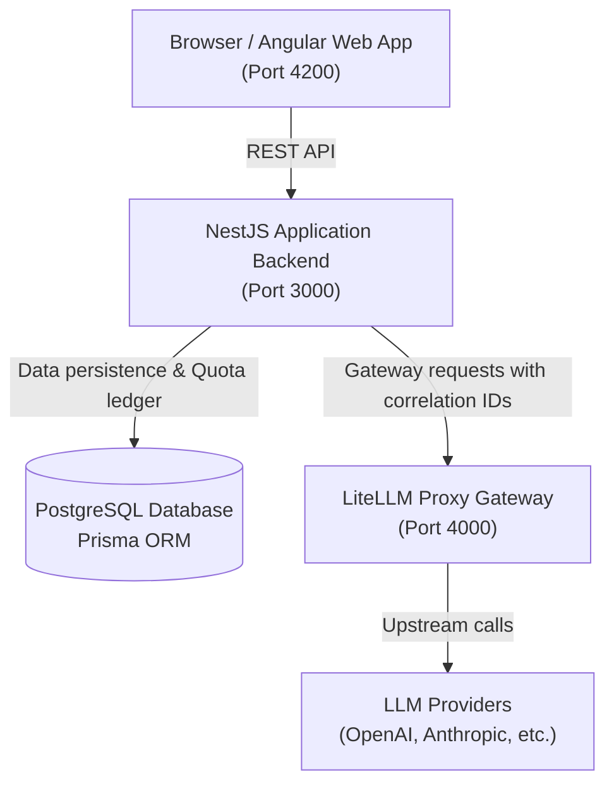

# PromptLab — System Architecture

## 1. Overview

PromptLab is a developer-focused Prompt Engineering and LLM Gateway platform. It enables engineers to design prompts with established techniques, manage immutable versioning, run side-by-side model experiments, maintain multi-turn conversations with context inspection and compaction, track token usage, and enforce monthly user token quotas.

## 2. Component Architecture

### Frontend (`apps/web`)
- **Framework:** Angular 19 (TypeScript, standalone components).
- **Styling:** Vanilla CSS design system adhering to `DESIGN_SYSTEM.md` using central CSS custom property design tokens (neutral palette, 4px grid, accessible focus states, no gimmicks/gradients).
- **Core Views:**
  - Prompt Studio (Library, Editor, Version History, Playground)
  - Compare (Side-by-side A/B model/prompt evaluation)
  - Conversations (Context inspector, compaction, checkpoints)
  - Usage & Quotas (Monthly token allowances, ledger)
  - Gateway & Observability (Traces, latencies, provider status)
  - Settings (Model configs, preferences)

### Backend (`apps/api`)
- **Framework:** NestJS 11 (Modular monolith).
- **Modules:**
  - `health`: Service and database readiness checks.
  - `auth`: User context and authorization.
  - `prompts`: Prompt templates, metadata, and immutable version storage.
  - `experiments`: A/B run definitions, executions, and evaluation scores.
  - `conversations`: Conversation sessions, message persistence, and checkpoint storage.
  - `context`: Token budget management, message truncation, and context compaction.
  - `providers`: LiteLLM gateway integration client and model availability.
  - `usage`: Quota policy, monthly period tracking, concurrency-safe token reservations, and reconciliation.
  - `observability`: Request tracing, correlation ID propagation, and error redaction.
- **ORM:** Prisma Client with PostgreSQL.

### Gateway & External Services
- **LiteLLM Proxy:** Separately hosted reverse proxy handling model routing, failover, upstream provider credentials, and gateway-level financial/rate limits.
- **Database:** PostgreSQL storing immutable versions, conversations, original messages, checkpoints, and usage records.

## 3. Phase 1 Data Flow: Prompt Studio & Gateway Execution

1. **Template Authoring:** The engineer writes a prompt template with dynamic variable syntax (`{{variable_name}}`) and selects composable technique metadata (e.g. `RTF`, `few-shot`, `structured-output`).
2. **Variable Resolution:** Template variables are dynamically parsed, sample values are substituted, and the exact assembled prompt text is generated while strictly preserving whitespace, line breaks, and indentation.
3. **Immutable Versioning:** Saving an edited prompt creates a new version record (`versionNumber = latest + 1`) linked to the parent prompt without modifying historical versions.
4. **Gateway Execution:** The NestJS `ProvidersService` submits the assembled prompt to LiteLLM Proxy (`/v1/chat/completions`) using the configured model. Response content, roundtrip latency, and token metrics with provenance labels (`provider-reported` vs `estimated`) are recorded.
5. **Honest Provider Error Handling:** If upstream credentials are unconfigured or fail authentication, an explicit provider configuration notice is returned without exposing API secrets or returning fake responses.

## 4. Security & Governance Principles
1. **Secrets Management:** Provider API keys remain strictly server-side inside gateway secrets or environment variables. No secrets are ever exposed in client bundles or client logs.
2. **Quota Enforcement:** Monthly token quotas are enforced in the NestJS application backend prior to gateway calls with concurrent reservation locking and post-call reconciliation.
3. **Observability:** Input/output tokens are distinguished; token counts are labeled *estimated* prior to execution and *provider-reported* once reconciled.
