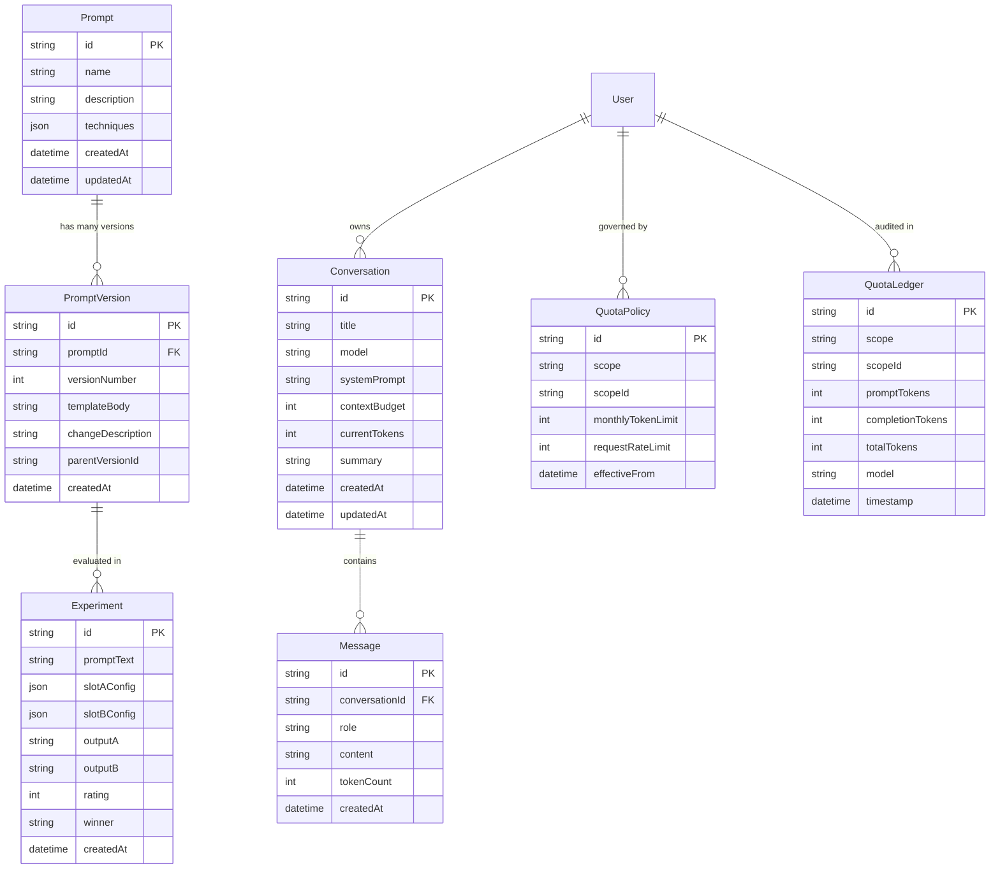

# Relational Data Model & Prisma Schema

## Overview
PromptLab uses PostgreSQL as its primary relational store, managed via Prisma (`apps/api/prisma/schema.prisma`).

## Entity Relationship Overview

## Column Types

### Enums
Closed sets of values are PostgreSQL enum types (Prisma `enum`), not free strings. Where a stored value contains a hyphen, the enum member is identifier-safe and `@map` keeps the database value unchanged.

| Enum | Column(s) | Values |
| :--- | :--- | :--- |
| `UserRole` | `users.role` (default `user`) | `admin`, `user` |
| `ConversationStatus` | `conversations.status` (default `active`) | `active`, `archived` |
| `MessageRole` | `conversation_messages.role` | `system`, `user`, `assistant` |
| `MessageStatus` | `conversation_messages.status` (default `complete`) | `complete`, `failed` |
| `ExperimentRunStatus` | `experiment_runs.status` | `completed`, `failed` |
| `TokenUsageSource` | `experiment_runs`, `usage_records`, `conversation_messages` (`tokenUsageSource`) | `estimated`, `provider-reported`, `estimated-timeout` |
| `QuotaPeriodStatus` | `quota_periods.status` (default `active`) | `active`, `closed` |
| `UsageStatus` | `usage_records.status` (default `reserved`) | `reserved`, `reconciling`, `reconciled`, `failed`, `timeout-ambiguous`, `expired` |
| `UsageOperation` | `usage_records.operation` (nullable) | `playground`, `comparison`, `conversation`, `compaction`, `gateway` |

The Prisma client returns the identifier-safe names (`timeout_ambiguous`, `provider_reported`, `estimated_timeout`). The public API keeps the hyphenated strings; conversion lives in `apps/api/src/common/enums/usage.enums.ts`. Raw SQL that binds an enum parameter must cast it (`${value}::"UsageOperation"`).

### Money
`experiment_runs.estimatedCost` and `usage_records.estimatedCost` are `DECIMAL(14,8)`. Prisma returns `Prisma.Decimal`; `decimalToNumber()` (`apps/api/src/common/utils/decimal.util.ts`) turns it into a plain JSON number at every response boundary, including `_sum` aggregates.

### JSON
`experiments.commonInput` is `JSONB` (a flat object of template variables), not a serialised string.

### Relations
`usage_records.conversationId` references `conversations.id` with `ON DELETE SET NULL`, so the ledger outlives a deleted conversation. `usage_records.operation` records which pipeline call reserved the usage (`LlmExecutionService`).

## Indexes
Besides the primary keys and unique constraints (which PostgreSQL also indexes), the schema defines indexes for every foreign key that is filtered on and for the hot list and background queries:

| Table | Index | Serves |
| :--- | :--- | :--- |
| `prompts` | `(ownerId, updatedAt)` | Prompt list, newest first |
| `experiments` | `(ownerId, createdAt)` | Comparison list, newest first |
| `experiment_runs` | `(experimentId)`, `(promptVersionId)` | Loading runs per experiment; `ON DELETE SET NULL` on prompt versions |
| `conversations` | `(ownerId, updatedAt)`, `(activeCheckpointId)` | Conversation list; `ON DELETE SET NULL` on checkpoints |
| `conversation_checkpoints` | `(conversationId, createdAt)` | Checkpoints per conversation, latest first |
| `quota_periods` | `(status, periodEnd)` | Closing expired periods (every minute) |
| `usage_records` | `(userId, createdAt)`, `(status, createdAt)`, `(conversationId)` | Usage ledger; stale-reservation sweeper (every minute); `ON DELETE SET NULL` on conversations |

`conversation_messages`, `prompt_versions` and `experiment_evaluations` are covered by their composite unique constraints, whose leading column is the parent ID.

## Schema Synchronization
- The database schema is versioned via Prisma migrations in `apps/api/prisma/migrations/`.
- Deploy migrations using `npm run prisma:push` or `npm run prisma:deploy` (`prisma migrate deploy`).
- Migrations are append-only: never edit one that has been applied; add a new migration instead.
- For new schema changes during development, use `npm run prisma:migrate` (`prisma migrate dev`).
