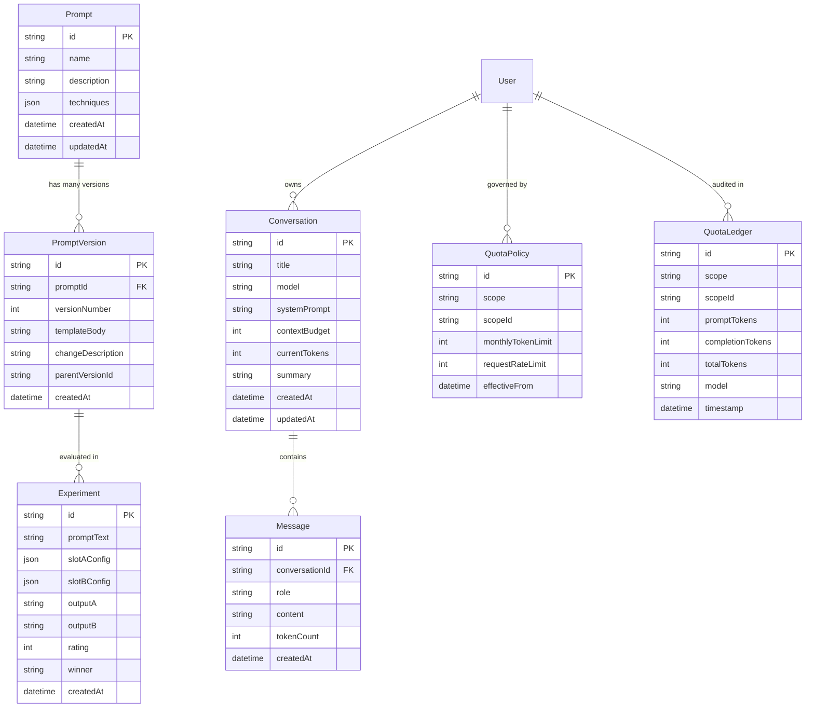

# Relational Data Model & Prisma Schema

## Overview
PromptLab uses PostgreSQL as its primary relational store, managed via Prisma (`apps/api/prisma/schema.prisma`).

## Entity Relationship Overview

## Schema Synchronization
- The database schema is versioned via Prisma migrations in `apps/api/prisma/migrations/`.
- Deploy migrations using `npm run prisma:push` or `npm run prisma:deploy` (`prisma migrate deploy`).
- For new schema changes during development, use `npm run prisma:migrate` (`prisma migrate dev`).
