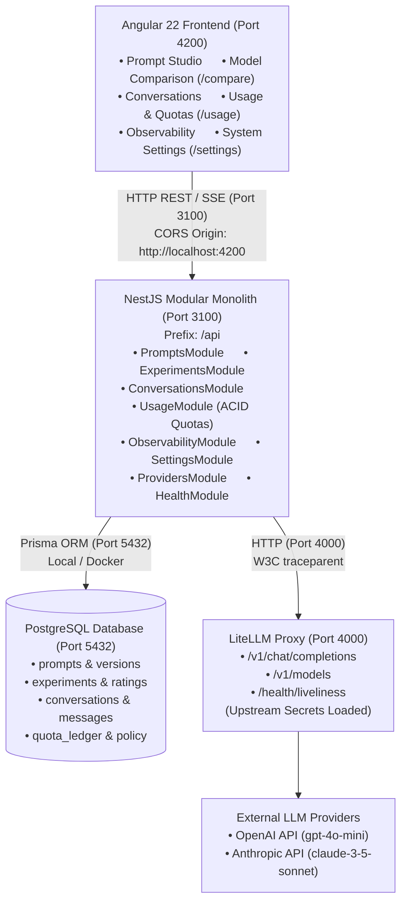

# System Topology & Network Architecture

## Architecture Diagram

## Network Ports & Protocols

| Service | Port | Protocol | Purpose |
| :--- | :--- | :--- | :--- |
| **Angular Web App** | `4200` | HTTP | Developer UI serving single-page application |
| **NestJS Backend API** | `3100` | HTTP | REST API under `/api` global prefix |
| **LiteLLM Proxy** | `4000` | HTTP | OpenAI-compatible gateway with server-side secrets |
| **PostgreSQL Database** | `5432` | TCP | Relational data persistence managed via Prisma |
| **OTEL Collector (Opt.)** | `4318` | HTTP | OpenTelemetry protocol telemetry sink |
| **Langfuse Server (Opt.)**| `3001` | HTTP | LLM application tracing and evaluation platform |

## Security & Boundary Invariants
1. **Zero Client Secrets:** Client browsers never handle or receive provider API keys or database connection strings.
2. **CORS Isolation:** Backend enforces strict origin filtering via `CORS_ORIGIN` (defaulting strictly to `http://localhost:4200`).
3. **Payload Boundaries:** Inbound request bodies are enforced to $\le$ 32KB text limits with class-validator validation pipelines.
