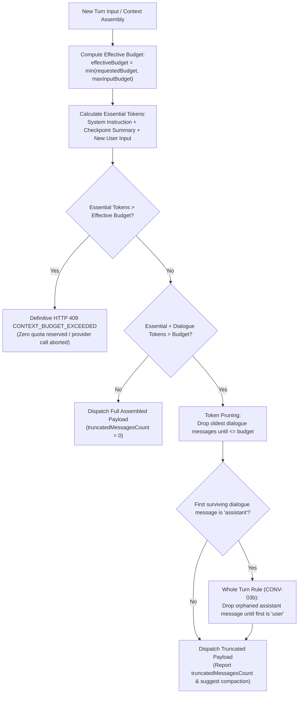

# ADR-009: Sliding Window Context Budget Enforcement with 409 Fallback

## Context
Multi-turn conversations accumulate tokens across turns, eventually approaching or exceeding conversation-specific token limits (`contextBudget`) or provider context windows. Without automated budget enforcement, oversized payloads cause upstream provider failures, wasted quota, or unbudgeted inference costs. Furthermore, `inspectContext` preview and `sendMessage` execution must remain strictly aligned to prevent divergence between user inspection and actual execution payloads.

## Alternatives Considered
1. **Immediate 409 Rejection on Any Overflow:**
   Return HTTP 409 `CONTEXT_BUDGET_EXCEEDED` whenever the total history exceeds the budget, requiring the user to manually compact history before sending any new message.
   - *Downside:* Highly disruptive user experience; minor token overflows halt active conversation flow.
2. **Naive FIFO Truncation:**
   Drop the oldest messages starting from index 0 until the total tokens fit within the budget.
   - *Downside:* Risks dropping the foundational system instructions (sequence 1) or the active checkpoint summary, causing the LLM to lose behavioral guidelines and previous facts. Can also leave an orphaned assistant reply at the beginning of dialogue history.
3. **Sliding Window over Dialogue Turns with Definitive 409 Fallback:**
   Pin essential elements (system prompt, active checkpoint summary, and proposed user input) so they are never dropped. Dynamically drop oldest uncompacted dialogue turns until within budget, ensuring the dialogue never starts with an orphaned assistant reply (whole turns). If the essential pinned messages alone exceed the budget, fail fast with HTTP 409 `CONTEXT_BUDGET_EXCEEDED` before quota reservation or provider dispatch.

## Decision
We chose **Alternative 3: Sliding Window over Dialogue Turns with Definitive 409 Fallback (CONV-03, CONV-03a, CONV-03b)**.

### Architectural Rules
1. **Shared Assembly Implementation:** Context assembly and token calculation are unified in a single shared function (`assembleConversationContext`), ensuring `inspectContext()` and `sendMessage()` execute identical truncation logic.
2. **Model Context Capping (CONV-03a):**
   - The effective budget is computed as:
     `effectiveBudget = min(requestedBudget, maxInputBudget)`
     where `maxInputBudget = contextWindow - reservedOutputTokens` when known, or `defaultInputBudget` when unknown.
   - Conversations created via `POST /api/conversations` clamp the stored `contextBudget` to `maxInputBudget` so database records remain bounded to actual provider limits.
   - `inspectContext()` returns both `requestedBudget` and `inputBudget`; the UI displays a notification if the requested budget was capped to the model's capacity.
3. **Pinned Elements:**
   - **System Instruction (Sequence 1):** Never dropped.
   - **Active Checkpoint Summary & Facts:** Never dropped.
   - **New User Message (Current Turn):** Never dropped.
4. **Sliding Window & Whole-Turn Pruning (CONV-03b):**
   - If total estimated tokens exceed the effective budget, oldest retained non-failed dialogue turns are dropped until within budget.
   - Dialogue must never start with an orphaned `assistant` message. If token-based pruning drops a user turn, subsequent pruning also drops the orphaned assistant reply so retained history always begins with a `user` turn.
5. **Definitive 409 Fallback:** If essential pinned tokens alone exceed `effectiveBudget`, the request is rejected with HTTP 409 `conflict('CONTEXT_BUDGET_EXCEEDED')` *before* quota reservation or provider dispatch, ensuring zero quota is billed.
6. **Observability & Compaction Suggestion:** `inspectContext()` reports `truncatedMessagesCount` so the UI visually alerts developers when messages are dropped and suggests running compaction.
7. **Scope Note:** `contextBudget` is currently supported through the API (`CreateConversationDto.contextBudget`); the web UI create modal does not yet expose an explicit budget input field and defaults to the model's budget.

## Consequences
- **Positive:**
  - Conversations continue smoothly without abrupt rejections for minor dialogue overflows.
  - Model context limits are respected safely even if an oversized `contextBudget` was requested.
  - Dialogue history remains grammatically coherent and compliant with provider APIs (no orphaned replies).
  - Essential instructions and compacted summaries are preserved with 100% fidelity.
  - Zero financial or token quota loss when a prompt is physically too large to fit the budget.
  - Strict consistency between context inspection preview and execution payload.
- **Negative:**
  - Very long dialogues with small budgets will experience memory loss of intermediate turns unless compacted.
- **Mitigation:**
  - UI actively surfaces truncation warnings and provides a one-click "Compact History" action.
