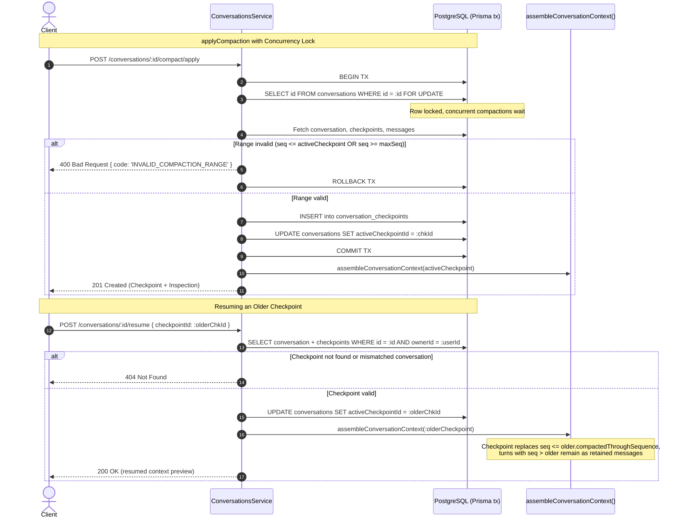

# ADR-010: Resumable Conversation Checkpoints and Compaction Validation

## Context
In PromptLab Phase 3, conversations can generate compaction checkpoints to synthesize previous dialogue into a concise summary with retained key facts. However, before resumable checkpoints and compaction validation were added:
1. `resume(checkpointId)` returned an inspection object but did not persist an active checkpoint pointer on the conversation. Consequently, subsequent context inspections and message dispatches reverted to the latest checkpoint or uncompacted history.
2. The semantic impact of resuming an older checkpoint on messages created after that checkpoint was ambiguous.
3. `applyCompaction()` lacked range validation matching `previewCompaction()`, allowing invalid checkpoint sequences (such as compacting beyond or through the latest message, or compacting backwards relative to the active checkpoint).
4. Concurrent compaction requests could race, creating overlapping checkpoints or corrupting the sequence progression.

## Alternatives Considered
1. **Destructive Checkpoint Resumption (Rollback):**
   Resuming an older checkpoint deletes all subsequent messages (`sequenceNumber > compactedThroughSequence`) from PostgreSQL.
   - *Downside:* Destroys transcript history and prevents users from branching or inspecting full conversational history. Violates the fundamental PromptLab guarantee that all original conversation turns are immutably preserved in PostgreSQL.
2. **Stateless Resumption via Request Headers:**
   Pass an optional `checkpointId` on every `sendMessage` and `inspectContext` call rather than storing state in the database.
   - *Downside:* Forces clients to track and propagate checkpoint IDs across sessions, complicates UI state management, and prevents multi-device consistency.
3. **Persisted Active Checkpoint Pointer with Retained Message Slicing & Pessimistic Row Locking:**
   - Add a nullable `activeCheckpointId` foreign key to `Conversation` (`ON DELETE SET NULL`).
   - Resuming an older checkpoint updates `activeCheckpointId`. Turns with `sequenceNumber > activeCheckpoint.compactedThroughSequence` remain in PostgreSQL and are passed into the context assembler as retained dialogue messages. The checkpoint replaces *only* the turns up to its `compactedThroughSequence`.
   - Validate `applyCompaction` range strictly: `compactedThroughSequence` must be `> activeCheckpoint.compactedThroughSequence` and `< latest message sequence`. Reject invalid ranges with HTTP 400 and `code: 'INVALID_COMPACTION_RANGE'`.
   - Serialize concurrent compactions using PostgreSQL pessimistic row locking (`SELECT "id" FROM "conversations" WHERE "id" = $id FOR UPDATE`) inside an atomic database transaction.

## Decision
We chose **Alternative 3: Persisted Active Checkpoint Pointer with Retained Message Slicing & Pessimistic Row Locking**.

### Architectural Rules

1. **Active Checkpoint Persistence:**
   - The `Conversation` table contains `activeCheckpointId` referencing `ConversationCheckpoint(id)` with `ON DELETE SET NULL`.
   - `resume(checkpointId)` validates that the checkpoint exists, belongs to the targeted conversation, and is owned by the authenticated caller. If valid, it updates `Conversation.activeCheckpointId` and returns the refreshed context inspection. If not found or belongs to another conversation/user, it throws HTTP 404 `NotFoundException`.
   - If `activeCheckpointId` is null (default), context assembly and `findOne()` fall back to the latest checkpoint if one exists, preserving backwards compatibility.

2. **Older Checkpoint Resumption Semantics:**
   - All conversation messages in PostgreSQL remain permanently preserved regardless of which checkpoint is active.
   - When an older checkpoint is active (e.g., compacted through sequence 4 in an 8-turn conversation), turns 1 through 4 are replaced by the checkpoint summary and retained facts. Turns 5 through 8 remain active uncompacted messages and participate in sliding-window truncation.
   - Both `inspectContext` preview and `sendMessage` payload dispatch evaluate the currently active checkpoint.

3. **Compaction Range Validation:**
   - `applyCompaction()` mirrors `previewCompaction()` validation:
     - `compactedThroughSequence` must be strictly greater than `activeCheckpoint.compactedThroughSequence` (or `0` if no active checkpoint).
     - `compactedThroughSequence` must be strictly less than the latest non-system message sequence (`maxSeq`), ensuring recent turns remain uncompacted for conversational continuity.
   - If either condition is violated, the API rejects the request with HTTP 400 and `{ message: string, code: 'INVALID_COMPACTION_RANGE' }`.

4. **Concurrency & Atomic State Transitions:**
   - In `applyCompaction()`, the conversation row is locked via `SELECT "id" FROM "conversations" WHERE "id" = ${id} AND "ownerId" = ${userId} FOR UPDATE;`.
   - Creating the `ConversationCheckpoint` record, updating `Conversation.activeCheckpointId`, and updating `Conversation.updatedAt` are executed in a single atomic database transaction. Concurrent compaction requests serialize cleanly on the row lock, preventing race conditions.

## Consequences

### Positive
- **Deterministic Checkpoint Switching:** Resuming checkpoints persistently modifies the conversation's active context for all future turns and inspections.
- **Transcript Safety:** Resuming an older checkpoint never discards or deletes subsequent turns from PostgreSQL.
- **Race Condition Prevention:** Row-level `FOR UPDATE` locking ensures concurrent compactions never create overlapping or interleaved checkpoints.
- **Client Clarity:** Structured error code `INVALID_COMPACTION_RANGE` allows client frontends to display precise validation guidance.

### Negative / Trade-offs
- Resuming an earlier checkpoint leaves more uncompacted dialogue messages in the active sliding window, which may cause older non-summarized turns to be truncated if the budget is tight.
- Row-level locking requires interactive database transactions; however, transaction durations are on the order of single-digit milliseconds as LLM summarization happens prior to `applyCompaction`.
