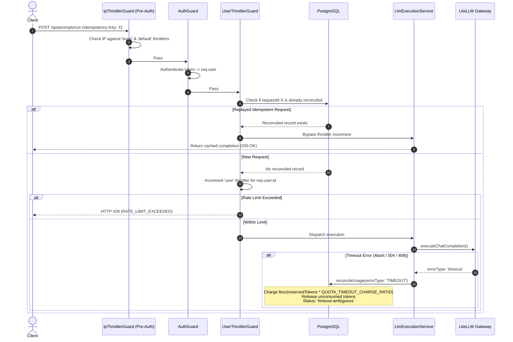

# ADR-011: Typed Timeout Reconciliation, Configurable Ambiguous Charge Policy, and Per-User Throttling

## Context
In PromptLab Phase 3 and Phase 4, token quota accounting and rate limiting protect upstream provider budgets and gateway capacity. However, the code review identified several heuristic shortcomings in accounting and rate limiting (QUOTA-06):
1. **Naive String Matching for Timeout Detection:** `reconcileUsage()` inspected `dto.error` using substring matches (`'timeout'`, `'timed out'`, `'ambiguous'`). An unrelated error message that incidentally contained the words "timed out" was erroneously classified as an upstream timeout, charging tokens for non-timeout failures.
2. **Hard-Coded Ambiguous Timeout Charge Ratio:** When an upstream timeout occurred, `reconcileUsage()` hard-coded a 50% charge of the reserved tokens, with no configuration mechanism or documented rationale.
3. **Accounting Policy Disparity (Expired vs Ambiguous):** The background sweeper (QUOTA-04) reclaims leaked reservations older than `2 × timeout + margin` and charges 0 tokens, whereas live timeout reconciliations charged 50%. The reasoning for this distinction needed clear documentation.
4. **Unbounded In-Memory Rate Limiting:** `UsageService.rateLimitTracker` maintained an unbounded, per-process `Map<string, number[]>` of request timestamps that was never evicted, reset on server restart, and counted requests *before* resolving idempotency keys. Replaying an idempotent request consumed an additional rate-limit unit and could trigger false 429 errors.
5. **Database Writes in Read-Only Status Endpoint:** `GET /usage/status` called `getCurrentPeriodRecord()`, which executed an `updateMany` query on every call to close expired quota periods, violating the read-only contract of GET operations.

## Alternatives Considered

1. **Keep In-Memory Map with TTL Eviction for Rate Limiting:**
   Add background cleanup intervals to `rateLimitTracker` to evict stale user timestamps.
   - *Downside:* Reinvents wheel; does not integrate with `@nestjs/throttler` guards, lacks standard `Retry-After` headers, and remains tied to a single process without path to distributed Redis storage.

2. **Deduct/Rollback Rate Limit Counter on Idempotency Replay:**
   Allow the throttler guard to increment on all incoming requests, and decrement the counter in the route handler or `LlmExecutionService` when a replay is detected.
   - *Downside:* `@nestjs/throttler`'s `ThrottlerStorage` interface only exposes `increment()`, with no atomic `decrement()` API. Furthermore, if a user was already at their rate limit, the initial increment would reject the replay with 429 before the handler could ever detect the replay.

3. **Check Idempotency Before Incrementing Counter with Named Throttler (Selected):**
   - Use a named `@nestjs/throttler` instance (`user`, 60 req/min) keyed by authenticated user ID (`req.user?.id`), applied exclusively to LLM-executing routes (`POST /api/prompts/run`, `/api/experiments/run`, `/api/conversations/:id/messages`, `/api/conversations/:id/compact/preview`).
   - Check the `Idempotency-Key` header against reconciled usage records before incrementing the counter; if a reconciled record already exists, bypass the counter increment completely.
   - Retain existing per-IP throttlers (`default` 60/min and `burst` 20/s) via a dedicated `IpThrottlerGuard` running before authentication.
   - Replace substring matching with typed `errorType === 'TIMEOUT'` mapped from `ProvidersService`.
   - Make the ambiguous charge ratio configurable via `QUOTA_TIMEOUT_CHARGE_RATIO` (0.0 to 1.0, default 0.5).
   - Move quota period closure to the background sweeper cron, making `GET /usage/status` strictly read-only.

## Decision

We chose **Alternative 3: Check Idempotency Before Incrementing Counter with Named Throttler, Typed Timeout Detection, Configurable Charge Ratio, and Read-Only Status (QUOTA-06)**.

### Architectural Rules

1. **Typed Timeout Detection:**
   - `ProvidersService.executeChatCompletion()` catches `TimeoutError` from `AbortSignal.timeout()` and maps HTTP 504/408 gateway responses to `errorType: 'timeout'`.
   - `LlmExecutionService` maps provider `timeout` and system `TimeoutError` / `ETIMEDOUT` to typed `'TIMEOUT'`.
   - `reconcileUsage()` evaluates *only* typed `dto.errorType === 'TIMEOUT'`. It performs zero substring matching against `dto.error`. If `dto.errorType` is not a timeout, 100% of reserved tokens are released with 0 tokens charged.

2. **Configurable Ambiguous-Charge Policy (`QUOTA_TIMEOUT_CHARGE_RATIO`):**
   - The ambiguous timeout charge ratio is governed by `QUOTA_TIMEOUT_CHARGE_RATIO` in `env.validation.ts` and `.env.example` (valid float between `0.0` and `1.0`, default `0.5`).
   - When an upstream provider times out, it is ambiguous whether the model generated partial output tokens before the connection severed. Charging `floor(reservedTokens * ratio)` balances provider financial exposure against user quota starvation.
   - If `QUOTA_TIMEOUT_CHARGE_RATIO` is set to `0`, 0 tokens are charged.
   - **Policy Distinction vs Expired Sweeper Reservations:**
     - *Expired Reservations (0 tokens charged):* The background sweeper reclaims reservations older than `2 × timeout + margin`. These represent abandoned requests, crashes, or uncompleted dispatches where no token consumption can be verified.
     - *Timeout-Ambiguous Reconciles (configured ratio charged):* These represent active HTTP dispatches confirmed to have reached the upstream gateway before timing out, carrying high likelihood of upstream compute consumption.

3. **Per-User Rate Limiting & Idempotency Bypass:**
   - Registered named throttler `user` (`ttl: 60_000`, `limit: 60`) in `ThrottlerModule.forRoot()`.
   - Global `IpThrottlerGuard` runs before `AuthGuard`, evaluating only `default` and `burst` limits keyed by client IP.
   - `UserThrottlerGuard` runs after `AuthGuard` and `RolesGuard`, decorated with `@ThrottleUser()` on the 4 LLM-executing endpoints:
     - `POST /api/prompts/run`
     - `POST /api/experiments/run`
     - `POST /api/conversations/:id/messages`
     - `POST /api/conversations/:id/compact/preview`
   - **Why Check Idempotency Before Counting:** Replaying an idempotent request with a previously reconciled `Idempotency-Key` serves a cached response and consumes zero LLM capacity. Checking idempotency *before* counting ensures that replayed retries do not increment the rate-limit counter, nor are they rejected with 429 if the user is currently at their quota. Replay lookups query `requestId IN [key, key:A, key:B]` to leverage the `(userId, requestId)` unique index.
   - **In-Flight Retries (`reserved` status):** Retries sent while an initial request is still in flight (its `UsageRecord` is `reserved` rather than `reconciled`) do count against the rate limit. This is intentional and acceptable: such concurrent re-sends immediately encounter a fast-fail 409 `REQUEST_IN_PROGRESS` without dispatching an upstream provider call, and counting them against the client rate limit naturally prevents runaway polling or thundering herds.
   - Dynamic user limit: If the user's database `QuotaPolicy` specifies a custom `requestRateLimit`, `UserThrottlerGuard` adopts that value as the active limit.
   - `rateLimitTracker` Map and all its call sites (`checkRateLimit`, `getRateLimitStatus`) are completely removed from `UsageService`.

4. **Multi-Instance Production Deployments (Redis Storage):**
   - For this single-process POC, `@nestjs/throttler` uses `ThrottlerStorageService` (in-memory).
   - In a multi-replica production deployment, rate-limit counters must be shared across pods using distributed storage (e.g. Redis via `throttler-storage-redis` or PostgreSQL sliding windows). This is out of scope for the POC.

5. **Read-Only `GET /usage/status`:**
   - `getStatus()` executes 3 concurrent read queries via `Promise.all` (`quotaPolicy.findUnique`, `quotaPeriod.findUnique`, and `usageRecord.aggregate`).
   - Zero database writes are performed (no `updateMany`, `update`, `upsert`, or `create`).
   - Closing expired quota periods (`periodEnd <= NOW() AND status = 'active'`) is delegated to `closeExpiredQuotaPeriods()` invoked by the scheduled `@Cron` sweeper.

