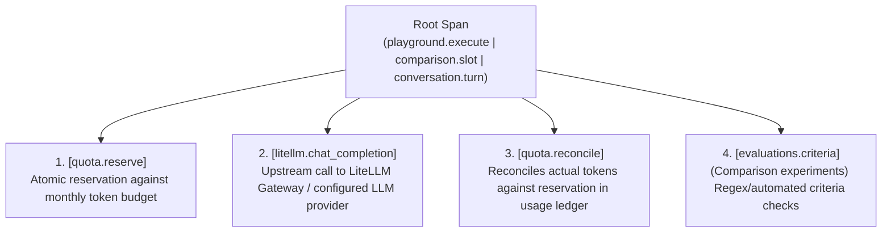

# Observability & Distributed Tracing Guide (Phase 5)

## 1. Overview
PromptLab Phase 5 introduces unified, end-to-end distributed tracing across all LLM operations:
- **Playground Executions (`playground.execute`)**
- **Side-by-Side Comparison Runs (`comparison.slot`)**
- **Conversation Turns (`conversation.turn`)**
- **Direct Gateway Requests (`gateway.request`)**

Tracing implements the W3C TraceContext standard (`traceparent` header `00-{traceId}-{spanId}-01`), propagates correlation identifiers to the LiteLLM Gateway (`x-litellm-trace-id`, `x-request-id`), supports optional OpenTelemetry (OTLP/HTTP) collectors, and integrates with Langfuse for generative AI observability.

### Instrumentation Approach: Custom Lightweight vs SDK
PromptLab uses **native, spec-compliant custom instrumentation and OTLP/HTTP export**:
- Emits W3C-standard 128-bit (32-character hex) trace IDs and 64-bit (16-character hex) span IDs.
- Directly serializes traces into standard OpenTelemetry Protocol (OTLP/HTTP v1/traces proto3 JSON) format with stringified 64-bit unix nano timestamps and strongly typed attributes (`intValue`, `doubleValue`, `boolValue`, `stringValue`).
- Avoids heavy Node.js auto-instrumentation monkey-patching and peer dependency conflicts across the workspace while ensuring 100% wire-compatibility with standard OpenTelemetry collectors, Datadog, Honeycomb, or Grafana Tempo.

---

## 2. Architecture & Span Hierarchy

Each LLM execution creates a root trace and child spans capturing specific stages of the lifecycle:



### Trace Context Propagation
When invoking LiteLLM Gateway (`ProvidersService.executeChatCompletion`), PromptLab injects:
- `traceparent: 00-{traceId}-{spanId}-01` (W3C TraceContext)
- `x-litellm-trace-id: {traceId}` (Native LiteLLM upstream correlation)
- `x-request-id: {requestId}` (Audit and quota ledger correlation)

---

## 3. Configuration & Environment Variables

Telemetry is enabled by default with local in-memory storage (ring buffer of up to 500 recent traces). External collectors are completely optional; if an external collector or network connection is unavailable, telemetry failures are caught and logged in the background and will **never** interrupt or fail user prompt executions or quota operations.

| Variable | Description | Default |
| :--- | :--- | :--- |
| `ENABLE_TELEMETRY` | Master switch to enable (`true`) or disable (`false`) all tracing. | `true` |
| `OTEL_EXPORTER_OTLP_ENDPOINT` | Standard OpenTelemetry Collector OTLP/HTTP endpoint (e.g. `http://localhost:4318/v1/traces`). | *(Unset / local buffer only)* |
| `LANGFUSE_PUBLIC_KEY` | Langfuse public API key (e.g. `pk-lf-...`). | *(Unset)* |
| `LANGFUSE_SECRET_KEY` | Langfuse secret API key (e.g. `sk-lf-...`). | *(Unset)* |
| `LANGFUSE_BASEURL` | Langfuse host URL (e.g. `https://cloud.langfuse.com` or `http://localhost:3000`). | `http://localhost:3000` |

---

## 4. Privacy, Security & Access Controls

PromptLab strictly enforces client and server-side secret scrubbing before traces are recorded or exported:
1. **Header and Secret Key Redaction:** Any key matching `/api[_-]?key/i`, `/secret/i`, `/auth(orization)?/i`, `/bearer/i`, `/password/i`, `/credential/i`, or auth token patterns has its value replaced with `[REDACTED]`.
2. **Raw Value Pattern Masking:** Strings matching `Bearer <token>`, `sk-...`, or `pk-...` are dynamically scrubbed and replaced with `[REDACTED_BEARER]` or `[REDACTED_API_KEY]`.
3. **Protection of Numeric Metrics:** Essential token count metrics (`inputTokens`, `outputTokens`, `totalTokens`, `promptTokens`, `completionTokens`, `reservedTokens`, `maxTokens`) and numeric properties are explicitly exempted from broad token-key redaction.
4. **No Prompt Payload Leaks:** Upstream provider API keys configured in LiteLLM are never forwarded into client-accessible spans. Traces retain operational metadata (IDs, models, latency, status, criteria results) without storing large prompt bodies or raw conversation transcripts in the trace record.
5. **Access Control Assumptions:**
   - In this single-tenant POC development setup, `/api/observability/*` and `/api/observability/clear` endpoints are open for local inspection, automated tests, and demo resets.
   - For multi-tenant production deployments, these endpoints must be guarded by administrative role-based access control (e.g. `@Roles('admin')`) to prevent unauthorized cross-tenant inspection or ring buffer tampering.

---

## 5. Fault Tolerance & Usage Ledger Isolation

- **Non-blocking Telemetry:** All network calls to external collectors (OTel OTLP or Langfuse) are executed asynchronously with a 2,000ms timeout. Collector failures or network timeouts never fail, delay, or block prompt executions, conversations, or quota reservations.
- **Bounded In-Memory Retention:** Local traces are stored in a ring buffer with a strict cap of 500 items, preventing memory leaks during long-running sessions.
- **Ledger Isolation (No Duplicate Accounting):** Telemetry export is purely observational and strictly isolated from the quota ledger. Token accounting and budget enforcement are persisted independently in PostgreSQL (`usage_records` and `quota_periods` tables). Telemetry exports never write duplicate ledger entries or mutate financial quotas.

---

## 6. Inspecting Traces in PromptLab UI

1. Open the PromptLab web UI (`http://localhost:4200`).
2. Click **Observability** in the left sidebar navigation (`/observability`).
3. **Telemetry Status Bar:** Displays tracing engine status, OTLP endpoint status, Langfuse connection state, privacy redaction guarantee, and total traces in the ring buffer.
4. **Trace Explorer:** Filter traces by status (`Success`, `Error`, `Rate Limited`), operation type, or model name.
5. **Waterfall Inspector:** Click on any trace row or **Inspect** button to open the waterfall drawer:
   - View root metadata, latency, tokens, cost, and W3C `traceparent` header with a 1-click copy button.
   - Inspect the child span timeline showing each operation's duration and relative start time.
   - Click any span to expand sanitized attributes.
6. **Clear Traces:** Allows clearing the local ring buffer for demo or test resets without impacting the persistent quota ledger.

---

## 7. Local Setup with OpenTelemetry or Langfuse (Optional)

### OpenTelemetry Collector (Docker Compose)
To forward traces to a local OpenTelemetry collector:
```yaml
# docker-compose.otel.yml
version: '3.8'
services:
  otel-collector:
    image: otel/opentelemetry-collector:latest
    ports:
      - "4318:4318" # OTLP HTTP receiver
```
Set in `apps/api/.env`:
```env
OTEL_EXPORTER_OTLP_ENDPOINT=http://localhost:4318/v1/traces
```

### Langfuse (Cloud or Self-Hosted)
To forward LLM generations and traces to Langfuse:
1. Create a free account or project at [cloud.langfuse.com](https://cloud.langfuse.com).
2. Generate API keys in **Project Settings -> API Keys**.
3. Set in `apps/api/.env`:
```env
LANGFUSE_PUBLIC_KEY=pk-lf-...
LANGFUSE_SECRET_KEY=sk-lf-...
LANGFUSE_BASEURL=https://cloud.langfuse.com
```
Restart PromptLab API (`npm run start:dev:api`). Traces and generations will appear in your Langfuse dashboard with full token usage, latency, and model metadata.
